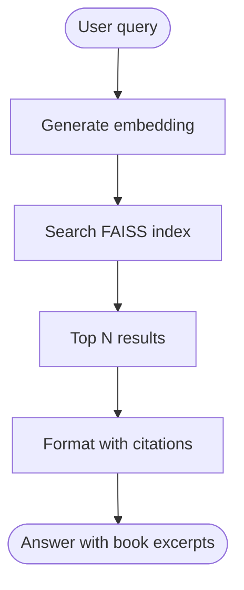

# Librarian

> **A BYOB (Bring Your Own Books) semantic search for your personal library.**

> All local (books, embedding models, database). Connect with your favorite AI provider and ask away.

Put EPUBs or PDFs in a folder. The Librarian indexes them locally and answers questions from them,
with citations you can open and verify against the exact paragraph.

**This README is written to be handed to an AI coding agent** (Claude Code, Codex, Cursor, or any
agent with shell access). Point the agent at this file and it has everything it needs: dependencies,
install, how a new book enters the corpus, and how to consult. Humans can follow it the same way.

---

## ⚠️ Read this first: what is and isn't ready

This release is **stateless-per-question** and ships **no managed MCP endpoint**. Two things that
people reasonably expect are **not available**, and pretending otherwise wastes your time:

| Expectation | Status | What actually works today |
|---|---|---|
| "Connect to Librarian's hosted MCP server" | ❌ **Not available** | No remote/hosted endpoint exists. The MCP server runs **on your machine, from your clone**. |
| "It remembers my reading history / personalizes over time" | ❌ **Not available** | Every query is independent. No cross-session memory, no user model. |
| Semantic search over your own books | ✅ **Works** | FAISS + `BAAI/bge-small-en-v1.5`, fully local. |
| Automatic indexing when you drop a book in a folder | ✅ **Works** | Folder watcher, incremental, seconds per book. |
| Citations you can verify | ✅ **Works** | Every hit resolves to a `book_id` + address + reader deep-link. |
| Ask through an AI agent | ✅ **Works** | MCP **stdio** server, or plain HTTP REST. |

> **The one-line truth:** Librarian is a **local library server you run yourself**, with an MCP stdio
> surface your agent launches. It is not a cloud product. Install it locally and it works; there is no
> hosted URL to paste anywhere.

---

## What you need before starting

| Requirement | Detail | Why |
|---|---|---|
| **Docker** | Docker Desktop (macOS/Windows) or Docker Engine + Compose (Linux) | Everything runs in one container. |
| **Compose** | `docker compose` (v2) **or** `docker-compose` (v1) | Either works. Commands below show both. |
| **Memory** | **16 GB** allocated to Docker | ⚠️ Default (7.6 GB) makes first indexing crash. Settings → Resources → Memory → 16 GB. |
| **Disk** | ~2 GB + your books | Deps, embedding model (~130 MB), index. |
| **OS** | macOS / Linux / Windows via WSL2 | |
| **Network** | Outbound HTTPS on **first start only** | Downloads the embedding model. After that it runs fully offline. |
| **Books** | `.epub` and `.pdf` | Other formats are ignored by the watcher. |

You do **not** need Python installed. You do **not** need an API key. Nothing leaves your machine
after the model is cached.

---

## Install and run — the exact sequence

### 1. Clone

```sh
git clone https://github.com/nonlinear/librarian.git
cd librarian
```

### 2. Point it at your books

The container mounts `${LIBRARY_ROOT:-./books}` → `/app/books`. Two options:

**Option A — use the bundled folder (simplest).** Copy your books into `./books/`:

```sh
cp ~/Downloads/*.epub ./books/
```

**Option B — keep your library where it is** (recommended if you already have a folder). Pass the
absolute path at startup:

```sh
export LIBRARY_ROOT=/absolute/path/to/my/library
```

Create that folder first if it does not exist — the mount fails on a missing host path.

> The repo ships `books/` **empty** on purpose. Librarian never distributes a corpus — the books are
> yours (BYOBook).

### 3. Start it

```sh
docker compose up -d
# if your machine only has the legacy binary:
docker-compose up -d
```

First start takes **~5–10 min** (image build) plus **~2–5 min** (model download + first index).
Subsequent starts are seconds.

### 4. Wait until it is actually healthy

Do not skip this. Watch the log until you see the HTTP server come up:

```sh
docker compose logs -f
```

Then confirm with a health check — this is the real signal:

```sh
curl -s localhost:8088/health
# {"status":"ok","service":"librarian-mcp","port":8088,"chunks":<n>}
```

`chunks: 0` means the server is up but nothing is indexed yet. That is expected on a fresh install
with an empty `books/`; it fills once books are present.

### 5. Add a book — auto-indexing

Drop an `.epub` or `.pdf` into your corpus folder (the one mounted as `LIBRARY_ROOT`, default
`./books`). The watcher:

1. detects the file, waits for the write to finish (debounce ~5 s),
2. spawns the indexer in the background,
3. reloads the search index when done — no restart needed.

Verify it landed:

```sh
curl -s localhost:8088/stats
# {"books":<n>,"chunks":<n>,"embedding_model":"BAAI/bge-small-en-v1.5",...}
```

Rules worth knowing:

- Only `.epub` and `.pdf` are indexed. Anything else is ignored silently.
- Files inside a folder named **`no-indexing/`** are skipped — use it to park books you don't want indexed.
- Indexing is incremental: one new book = seconds, not a full rebuild.
- If indexing looks stuck, `docker compose logs --tail=50` shows the watcher and indexer output.

### 6. Consult the books

Three surfaces. Pick whichever fits your agent.

#### a) CLI inside the container — fastest smoke test

```sh
docker compose exec librarian python3 /app/engine/scripts/faiss_search.py "mutual aid and care"
```

#### b) HTTP REST — for scripts and manual checks

```sh
# semantic search
curl -X POST localhost:8088/search \
  -H 'Content-Type: application/json' \
  -d '{"query":"mutual aid and care","limit":5}'

# resolve a hit into a reader deep-link
curl -s localhost:8088/resolve/<chunk_id>
# → {"book_id":..., "address":..., "reader_url":...}

# read one chunk
curl -s localhost:8088/chunk/<chunk_id>

# readiness / inventory
curl -s localhost:8088/health
curl -s localhost:8088/stats
```

#### c) MCP stdio — how your AI agent actually consumes it

Librarian's MCP server is **stdio**, not HTTP-on-a-port. Your agent **launches it as a subprocess**.
There is no port to connect to and no URL to paste.

```sh
docker compose exec -T librarian python3 /app/engine/scripts/mcp_server_faiss.py
```

The server speaks JSON-RPC over stdin/stdout. The tool it exposes on this release:

| Tool | Args | Returns |
|---|---|---|
| `search_library` | `query` (required), `k` (default 10), `min_score` (optional) | hits with `chunk_id`, `book_id`, `score` |

> The stdio server loads the 1.2 GB FAISS index **lazily** on the first `search_library` call, so the
> `initialize` handshake returns immediately. A slow first query is normal; it is not a hang.

**Example MCP client config** (shape varies per client — this is the structure agents need):

```json
{
  "mcpServers": {
    "librarian": {
      "command": "docker",
      "args": [
        "compose", "exec", "-T", "librarian",
        "python3", "/app/engine/scripts/mcp_server_faiss.py"
      ],
      "cwd": "/absolute/path/to/librarian"
    }
  }
}
```

If your client runs inside the same Docker network instead of the host, pointing at the container
directly works too — the important part is that **stdio is the transport**.

#### d) Reader — verify a citation with your own eyes

```
http://localhost:8088/reader/<book_id>     # opens the book at the cited paragraph, highlighted
http://localhost:8088/wall                 # library wall
```

This is the point of the product: `search_library` / `/search` returns an address, `/resolve` turns it
into a `reader_url`, and the reader shows you the actual sentence. You confirm the answer is grounded
instead of trusting it.

---

## End-to-end acceptance check

Run this after install. If all four pass, Librarian is working on your machine.

```sh
# 1. server is up
curl -s localhost:8088/health

# 2. corpus is indexed (books > 0 after adding at least one book)
curl -s localhost:8088/stats

# 3. a query returns hits
curl -s -X POST localhost:8088/search \
  -H 'Content-Type: application/json' \
  -d '{"query":"a phrase you know appears in your book","limit":3}'

# 4. a hit resolves to a reader link
curl -s localhost:8088/resolve/<chunk_id from step 3>
```

---

## Troubleshooting

| Symptom | Cause | Fix |
|---|---|---|
| `/health` never answers | Model still downloading, or first index running | `docker compose logs -f`; wait for the HTTP server line. |
| Container restarts in a loop | Docker memory < 16 GB → OOM on first index | Raise Docker memory to 16 GB, then `docker compose up -d`. |
| Model download fails / times out | No outbound HTTPS on first start, or proxy | Retry with network access. Only the first start needs it. |
| `chunks: 0` forever | Books folder empty or not mounted where you think | Check `docker compose exec librarian ls /app/books`. |
| A book is not indexed | Wrong extension, or inside `no-indexing/` | Only `.epub`/`.pdf`; move it out of `no-indexing/`. |
| `docker compose` not found | Machine only has legacy Compose | Use `docker-compose` instead. Both are supported. |
| Port 8088 already in use | Another service on 8088 | `LIBRARIAN_READER_PORT=8090 docker compose up -d`. |
| MCP client shows no tools | Client pointed at a port instead of launching stdio | Use the stdio config above; there is no MCP HTTP endpoint. |

---

## Possible uses

| | Description |
| :-- | :-- |
| ⚖️ **Compliance** | Collect compliance and regulation manuals to test a new idea the proper way |
| 🔧 **Home fixes** | Move all your home devices and appliances' manuals + warranties, ask troubleshooting questions |
| 🌱 **Gardening** | Permaculture, indigenous plant guides, water management books to redesign your garden with less trial-and-error |
| 🎸 **New hobby** | Collect authoritative books in a field you want to learn, reduce your confusion by asking freely |
| 🎮 **Game dev** | Design patterns, procedural generation, narrative theory — query mid-project to find which book explained that algorithm |
| 🌍 **Academic** | Anthropology, ethnography, linguistics — entire library indexed locally, works offline for weeks in remote locations |
| 💼 **Professional** | Legal texts, industry whitepapers, case studies — cite exact sources during audits or client presentations |
| 💪 **Fitness** | Training programs, nutrition guides, sports science — grounded advice without influence rabbit holes |

## Features

🏠 **All local:** No API calls, works offline  
🧠 **Semantic search:** Not just keywords  
👁️ **File watcher:** Drop book in folder → indexed automatically  
⚡ **Incremental indexing:** Add books → auto-reindex in <10s  
🔌 **MCP server:** Claude Desktop / OpenClaw integration (stdio)  
📖 **EPUB reader:** Deep linking to exact paragraphs  
🔒 **Stable IDs:** Content-addressed, survives renames  

---

## Example queries

- "Research on what do I have about design systems?"
- "Consult books on mutual aid and care"
- "Consult on how do taxonomies differ from folksonomies?"

---

## How it works




---

## Performance

| Library size | Index time | Query time | Disk space |
|--------------|------------|------------|------------|
| 100 books    | 2-5 min    | <0.3s      | ~100 MB    |
| 500 books    | 10-15 min  | <0.5s      | ~400 MB    |
| 1000 books   | 20-30 min  | <0.7s      | ~800 MB    |

**After initial index:** adding 1 book takes <10s.

---

## Configuration

Config resolves in this order (highest wins): `config.json` → environment variables → defaults
derived from `library_root`. See [`about/configuration.md`](about/configuration.md).

Common environment variables:

| Variable | Default | Meaning |
|---|---|---|
| `LIBRARY_ROOT` | `./books` | Host path mounted as the corpus |
| `LIBRARIAN_BOOKS` | `/app/books` | Corpus path **inside** the container |
| `LIBRARIAN_READER_PORT` | `8088` | Host + container port for HTTP/reader |
| `LIBRARIAN_MODELS_DIR` | `./models` | Embedding model cache (persist across rebuilds) |
| `LIBRARIAN_MODEL` | `BAAI/bge-small-en-v1.5` | Embedding model |

---

## Documentation

| Doc | Purpose |
|-----|---------|
| [`about/README.md`](about/README.md) | Overview + use cases |
| [`about/install.md`](about/install.md) | Install from zero (BYOBook) |
| [`about/configuration.md`](about/configuration.md) | How config is resolved (env / config.json / defaults) |
| [`about/features.md`](about/features.md) | Official capabilities, verified against code |
| [`about/usage.md`](about/usage.md) | How to consume: MCP, HTTP, reader, CLI |
| [`about/troubleshooting.md`](about/troubleshooting.md) | Problem → diagnosis → fix |

---

## Tech stack

- **`engine/scripts`** — indexing, retrieval, FAISS search, file watcher, HTTP/MCP servers
- **`engine/reader`** — EPUB reader shell (deep-links + highlight)
- **`engine/shared`** — shared response/evidence models (single source of truth)
- **`engine/evidence_renderer`** — renders evidence with citation targets
- **`config.example.json`** — generic config template (no instance paths)

Python 3.11 · FAISS · sentence-transformers · FastAPI · epub.js

---

## Credits

- **[FAISS](https://github.com/facebookresearch/faiss):** Meta AI (vector search)
- **[Sentence Transformers](https://www.sbert.net/):** HuggingFace (embeddings)
- **[epub.js](https://github.com/futurepress/epub.js/):** FuturePress (EPUB rendering)
- **[FastAPI](https://fastapi.tiangolo.com/):** Sebastián Ramírez (web framework)

---

**Built by [Nonlinear Studio](https://nonlinear.nyc)**
