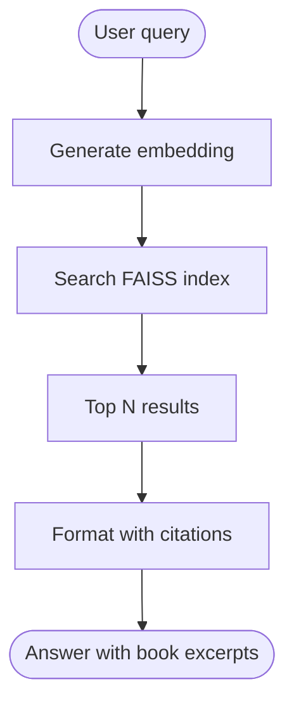

# Librarian

> A BYOB (Bring Your Own Books) semantic search for your personal library.

> All local (books, embedding models, database). Connect with your favorite AI provider and ask away.

## Documentação de produto

| Doc | Para quê |
|-----|----------|
| [`install.md`](install.md) | Instalar e rodar do zero (BYOBook) |
| [`configuration.md`](configuration.md) | Como o Librarian resolve config (env / config.json / defaults) |
| [`features.md`](features.md) | Capacidades oficiais (verificadas contra o código) |
| [`usage.md`](usage.md) | Como consumir: MCP, HTTP, reader, CLI |
| [`troubleshooting.md`](troubleshooting.md) | Problema → diagnóstico → solução |

---


---

| Possible uses               | Description                                                                                                                                                     |
| :-------------------------- | :-------------------------------------------------------------------------------------------------------------------------------------------------------------- |
| ⚖️&nbsp;**Compliance**      | Collect all compliance and regulation manuals to test a new idea the proper way                                                                                 |
| 🔧&nbsp;**Home&nbsp;fixes** | Move all your home devices and appliances' instruction manuals + warranties, ask troubleshooting questions                                                      |
| 🌱&nbsp;**Gardening**       | Permaculture, indigenous plant guides, water management books to redesign your garden with less trial-and-error                                                 |
| 🎸&nbsp;**New&nbsp;hobby**  | Wanna try a new hobby but have no idea of scope? Collect authoritative books in the field you wanna learn, and reduce your confusion by asking freely questions |
| 🎮&nbsp;**Game&nbsp;Dev**   | Design patterns, procedural generation, narrative theory—query mid-project to find exactly which book explained that algorithm                                  |
| 🌍&nbsp;**Academic**        | Anthropology, ethnography, linguistics—entire library indexed locally, works offline for weeks in remote locations                                              |
| 💼&nbsp;**Professional**    | Legal texts, industry whitepapers, case studies—cite exact sources during audits or client presentations                                                        |
| 💪&nbsp;**Fitness**         | Training programs, nutrition guides, sports science—get grounded advice without influence rabbit holes                                                          |

## Features

🏠 **All local:** No API calls, works offline  
🧠 **Semantic search:** Not just keywords  
👁️ **File watcher:** Drop book in folder → indexed automatically  
⚡ **Incremental indexing:** Add books → auto-reindex in <10s  
🔌 **MCP server:** Claude Desktop / OpenClaw integration  
📖 **EPUB reader:** Deep linking to exact paragraphs  
🔒 **Stable IDs:** Content-addressed, survives renames  

---

## Example Queries

- "Research on what do I have about design systems?"
- "Consult books on mutual aid and care"
- "Consult on how do taxonomies differ from folksonomies?"

---

## Requirements

1. Docker Desktop

   - Memory: **16GB minimum** (Settings → Resources → Memory)

   - ⚠️ **Critical:** Default 7.6GB will cause indexing to crash

   - Disk space:** ~2GB (dependencies + models)

2. macOS/Linux (Windows: use WSL2)

3. Any AI system with access to local files + MCP capabilities

---

### Installation

#### Clone the repo

```
git clone https://github.com/nonlinear/librarian.git librarian
cd librarian
```

#### Start Docker Desktop and increase memory

Settings → Resources → Memory → 16GB → Apply & Restart

#### Start the container

```
cd librarian
docker compose up -d
```

This will:

- Build the Docker image (~5-10 min first time)
- Download the embedding model (~130MB, cached for future runs)
- Index any book on the `./books` folder (mount `LIBRARY_ROOT` to your corpus; ~2-5 min for 3 test books)

> The `books/` directory is a volume you provide (BYOBook); the engine never ships a corpus. Point
> `LIBRARY_ROOT` at your own library folder before first start.

#### Query via MCP

Configure your agent with the MCP endpoint served by the container and ask away. Example triggers:
"consult", "research".

#### Optional: check logs

```
docker compose logs -f
```

#### Try your first query

> Consult books on white rabbit, wonderland

> Research monster creator regret

CLI query inside the container:

```
docker compose exec librarian python3 /app/engine/scripts/faiss_search.py "query"
```

---

## Reader (deep-links to exact paragraphs)

The container serves an EPUB reader that deep-links retrieval to the exact source paragraph. When the
semantic search returns an evidence chunk, the reader opens the book at that paragraph and highlights it,
so you can verify the answer against the original text.

- Reading UI: `http://localhost:8088/reader/{book_id}`
- Wall: `http://localhost:8088/wall`

---

## How it works



---

## Performance

| Library Size | Index Time | Query Time | Disk Space |
|--------------|------------|------------|------------|
| 100 books    | 2-5 min    | <0.3s      | ~100 MB    |
| 500 books    | 10-15 min  | <0.5s      | ~400 MB    |
| 1000 books   | 20-30 min  | <0.7s      | ~800 MB    |

**After initial index:** Adding 1 book takes <10s.

---

## Tech stack

- **`engine/scripts`** — indexing, retrieval, FAISS search, file watcher, HTTP/MCP servers
- **`engine/reader`** — EPUB reader shell (deep-links + highlight)
- **`engine/shared`** — shared response/evidence models (single source of truth)
- **`engine/evidence_renderer`** — renders evidence with citation targets
- **`config.example.json`** — generic config template (no instance paths)

Config is parametric: use environment variables (`LIBRARIAN_BOOKS`, `LIBRARIAN_MODELS`) or the resolved
config template to point the engine at your corpus. No instance-specific path is required.

---

## Credits

- **[FAISS](https://github.com/facebookresearch/faiss):** Meta AI (vector search)
- **[Sentence Transformers](https://www.sbert.net/):** HuggingFace (embeddings)
- **[epub.js](https://github.com/futurepress/epub.js/):** FuturePress (EPUB rendering)
- **[FastAPI](https://fastapi.tiangolo.com/):** Sebastián Ramírez (web framework)

---

**Built by [Nonlinear Studio](https://nonlinear.nyc)**
