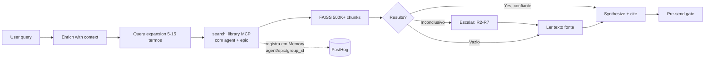
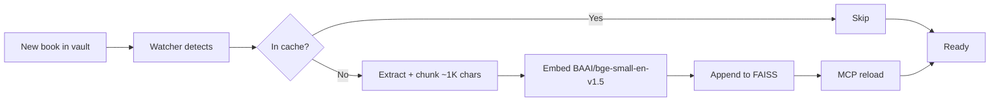

# Librarian — Semantic Book Search

v3.5.0. 1100+ EPUBs, 500K+ chunks, <1s search.

**Changelog (v3.5.0, 2026-10-19):** `description` rewritten. It said *"Use when the user
EXPLICITLY consults you"* — a description-level prohibition on proactivity, and the description is
the ONLY triggering mechanism. Owner's report: *"funciona de boa, o único problema é que não é
proativo, eu preciso pedir."* Also corrected stale corpus size in the description (290 → 1100+).
No behavioural rule changed; only the trigger.

**Changelog (v3.4.0):** added mandatory Research Protocol (8 rules): query expansion,
primary source first, structure-aware navigation, escalate-don't-conclude, hybrid
retrieval, dedup copies, cite-or-didn't-happen. Updated Query Flow to show escalation
path. Updated stats from 290/167K to 1100+/500K+.

**Changelog (v3.3.0):** activation gate (fail-closed: read SKILL.md this turn),
Activation Self-Audit table, widened triggers to implicit library questions.

**Changelog (v3.2.0):** added a pre-send Output Format gate (fail-closed), promoted
"EPUB citation without a reader deep-link" to a first-class Hard Stop, split
Research/Present into two explicit phases, added a `formal:` output toggle, and
added an "open SKILL.md this turn" activation line. v3.1.0 had no format gate —
pre-v3.2.0 violations pin to the old contract, not this one.

---

## Activation (HARD GATE — fail-closed)

**If you did not open this SKILL.md this turn, open it now. Do NOT call
`librarian__search_library` (or any librarian MCP tool) without first reading
this file in this turn.**

> #### ACTIVATION GATE (MANDATORY — same weight as the PRE-SEND GATE)
>
> A library-consultation is NOT a bare MCP tool call. It is a *skill invocation*
> with a two-phase contract (Research → Present) and a MANDATORY Output Format
> (1️⃣2️⃣3️⃣ markers, `Fontes:` section, EPUB deep links, fail-closed pre-send gate).
> Calling the tool without loading this skill = executing half the contract.
> That is a violation, not a shortcut.
>
> **Check before sending:** did this turn include `read` of this SKILL.md?
> No → do not search, do not answer. Open the file, then proceed.

**Use when the user explicitly says:** `consult books`, `consult`, `consulte`, `Librarian`,
**or asks anything sourced from the library acervo / the books** (a question whose
answer should cite indexed books). When in doubt, treat it as an activation.

**Do NOT use it to search the web or answer from raw memory** — if the answer should
come from the library, it is a library consultation even if the user didn't say the
magic word.

**Last-resort guard:** if you answered a library-adjacent question and are about to
send without citations, stop — that is the failure this gate exists to close.

---

## Query Flow



**Timing:** ~1-2s total.

---

## Query Assembly (MANDATORY before MCP)

**Problem:** MCP is stateless; agent holds conversation context. Bridge them.

**Steps:**
1. Scan last 2-3 user turns; extract entities (authors, titles, concepts).
2. **EXPAND the query before calling FAISS.** The user's vocabulary ≠ the book's
   vocabulary. Generate 5-15 search terms across 4 layers before composing the
   final query:
   - **lexical** (synonyms: e.g. insect → arthropod, bug, swarm, chitin)
   - **functional** (what it does: e.g. "parallel computing", "emergent computation",
     "collective behavior")
   - **contextual** (domain: e.g. "Autoverse", "biological substrate",
     "cellular automaton")
   - **proper nouns** (character/place/artifact names within the book)
   Concatenate the 2-3 most promising into a single query. FAISS is semantic, but
   embedding coverage varies — expanding the terms covered increases recall.
3. Classify: **Follow-up** (pronouns, deixis) → enrich. **Standalone** → pass literal.
4. Compose: `[query] [entities from context, ~150-200 chars]`

**Example:**
```
Turn N-2: "Baudrillard simulacra"
Turn N:   "e a magia do caos?"
→ expand: ["chaos magick", "belief + reality", "Tymoczko", "Hutton", "occult +
  simulacra", "Carroll + chaos"]
→ search_library merged results
```

**Fallback:** If uncertain, run 2-3 expanded variants, merge results, dedupe by chunk_id.

---

## Research Protocol (MANDATORY — 8 regras)

Uma busca no FAISS não é um resultado — é uma **hipótese de trabalho**. Concluir sobre
conteúdo de livro só depois de ler o texto extraído, nunca consultando só o índice.

### Regra 1 — Expansão de query (mandatory)

Nunca chame FAISS com a query crua. Expanda para 5-15 termos em 4 camadas:
- **Lexical:** sinônimos ("bug" → "insect / error / defect")
- **Funcional:** o que faz ("dance" → "parallel computing / emergent computation")
- **Contextual:** domínio ("Autoverse / biological substrate")
- **Proper nouns:** personagens, lugares, artefatos

Merge os resultados dos sets. Dedup por chunk_id.

```
Query raw:   "insetos dançam computação hackeiam nave"
Expanded:   "Lambertians swarm dance mathematics",
            "parallel computing insect colonies",
            "biological computation Autoverse",
            "Repetto Mouthpiece Contact Group",
            "Ambassador spaceship Planet Lambert",
            "field equations cellular automaton"
```

### Regra 2 — Fonte primária primeiro

Se o arquivo está na biblioteca, o TEXTO é canônico. Fontes secundárias (Wikipedia,
resenhas, sumários) dão contexto, nunca prova. Leia o arquivo antes de citar qualquer
coisa externa.

### Regra 3 — Navegação estrutura-aware

Extraia o TOC/spine primeiro, mapeie termos → capítulos, leia as seções relevantes.
Não conclua só de grep.

### Regra 4 — Ausência de evidência ≠ evidência de ausência

Uma busca sem resultado não prova nada. Afirmar "não está no livro" exige exaurir o
texto.

### Regra 5 — Escalone, não conclua

Pipeline obrigatório: query expandida → variações → termos conceituais → dump do texto
completo → leitura. Só então conclua.

### Regra 6 — Retrieval híbrido

FAISS para recall + grep no texto extraído para precisão. Nenhum substitui o outro.

### Regra 7 — Dedup copies / verifique cobertura do índice

Um mesmo livro pode estar indexado sob múltiplos hashes (excerpt vs edição completa).
Verifique o que realmente existe e a cobertura de capítulos ANTES de julgar falha de
busca.

### Regra 8 — Cite ou não aconteceu

Toda afirmação sobre texto cita chunk + book_hash + capítulo/seção.

### Uma linha

> Nunca conclua antes de ler o texto. O índice é um ponteiro, não a resposta.

---

## Activation Self-Audit (run before ANY answer)

| Check | Pass? |
|-------|-------|
| Used SKILL.md this turn (activation gate) | |
| Performed query expansion (lexical+functional+contextual+proper) before search | |
| Every claim carries a 1️⃣2️⃣3️⃣ marker | |
| Fontes section present (unless `formal:false`) | |
| Every EPUB source has a reader deep-link | |
| Every author from MCP `book_author`; omitted if Unknown | |
| If 0 results: escalated through Research Protocol (variations → text dump → read) before concluding | |
| Every source citation cites chunk + book_hash + chapter | |
| (README: rules above are MANDATORY, not optional — a bare citation without a deep link,
  prose without 1️⃣2️⃣3️⃣ markers, or a conclusion from a single failed query is a format failure)

---

## MCP Call

```python
search_library(query, k=10, min_score=None, agent=None, epic=None, session_id=None)
```

**Contexto de memória (MANDATORY — o MCP não infere; o OpenClaw injeta o agent):**
- `agent` = **vem do OpenClaw automaticamente** (`x-openclaw-agent-id` header) — o
  runtime sabe quem está chamando; não precisas passar. Se passares, é usado como
  fallback; se não, o header vence.
- `epic` = **o TÓPICO** da consulta (o assunto, ex: `index-integrity`, `chaos-magick`),
  não o epic formalizado do backstage (P10Exxx — artifact de governança). O skill
  pergunta ao chamador pelo tópico; pode ou não saber; se não souber, deixa vazio
  (ok — a memória fica sem tópico, não quebra).
- `session_id` = id da conversa/sessão, se disponível.
- O MCP registra estes no PostHog/Memory (Event Contract v2.1). Sem epic, a
  memória registra agent (do header) + epic vazio — rastreável por agente, não por projeto.
- **NUNCA deixe de perguntar o epic quando fizeres sentido** — o skill é o
  "instrumentation at the edge": o contexto existe no chamador.

**Returns:**
```json
[{"text": "...", "book_title": "...", "book_author": "...", "score": 0.81, "book_id": "<book_id>", "source": {"type": "epub", "href": "OEBPS/ch01.xhtml"}}]
```

**Container:** `librarian`, port 8088.

---

## Output Format (MANDATORY)

**Canonical complete answer** (body + Fontes + Similarity) — the shape every
non-`formal:false` answer must match. [Full example rendered below in Source Format.]

```
<2-4 sentence synthesized answer, every claim carrying a 1️⃣2️⃣3️⃣ marker>

> **Fontes:**
>
> 1️⃣ [Book Title](<reader deep-link>), Author (Year)   ⭐⭐⭐⭐+
> 2️⃣ [Book Title](<reader deep-link>), Author (Year)   ⭐⭐⭐
> 3️⃣ PDF Book Title, Author (Year) p. N   *(PDF — sem link)*
```

1. **Synthesize** a coherent answer (not raw chunks).
2. **Inline citations** 1️⃣ 2️⃣ 3️⃣ (marking each synthesized claim).
3. **Every EPUB citation MUST carry a reader link.** The citation names the book
   (title + author) and embeds the deep link to the exact passage, so the user
   can read the synthesized claim inline **or click and read the full passage in
   the Reader**. **(PDF sources: NO link — the Reader does not render PDFs; see
   Source Format.)**
4. **NEVER print a page number** (`p.XX`) for an EPUB — it has no fixed pages.
   For a **PDF**, a page number is valid (it has pages) and MAY be shown (e.g.,
   `p. 337`) to help the user locate it, but the PDF never gets a clickable reader
   link.
5. **Stars:** ⭐⭐⭐⭐⭐ (≥0.9), ⭐⭐⭐⭐ (≥0.8), ⭐⭐⭐ (≥0.7).

> **Violation rule:** an EPUB citation without a reader deep-link is a violation. The
> deep link is the evidence the user clicks; a book name alone is not a navigable
> source. This applies to EPUB sources only — PDF sources carry no link by design.
> Every EPUB source MUST link; every PDF source MUST NOT.
>
> ### PRE-SEND GATE (fail-closed — pass every check or revise)
>
> Before sending any answer, run this checklist. **Any failing check → do not send.**
> This carries the same weight as the "No results" hard stop — a format failure is
> a failure, not a style preference.
>
> 1. **Every synthesized claim carries a 1️⃣ 2️⃣ 3️⃣ marker inline.** No claim floats
>    without a citation marker.
> 2. **Every EPUB source carries a reader deep-link** built from `book_id` + `source.href`
>    + a ~60-char `t=` locator derived from real text. **Exception (fail-closed, both
>    sides): if the `book_id`/`href` is invalid or missing, do NOT fabricate a link —
>    emit NO link and flag the citation as `source link unavailable`.**
> 3. **Every PDF source carries NO link.** A PDF may show `p.N` from `source.page`;
>    it never gets a clickable reader URL (the Reader does not render PDFs).
> 4. **Every author in a citation comes from the MCP `book_author` field.** If absent
>    or "Unknown", omit the author — never fill from memory, guess, or publisher.
> 5. **A "Fontes:" section lists all sources** (unless `formal:false`), each carrying the
>    correct ⭐⭐⭐⭐/⭐⭐⭐ level per the similarity scale (⭐⭐⭐⭐⭐ ≥0.9, ⭐⭐⭐⭐ ≥0.8,
>    ⭐⭐⭐ ≥0.7) derived from the MCP `score` in the working table.
>
> ### `formal:` toggle
>
> Default is `formal: true` — full gate, full Fontes section. Callers that want a
> tight/quick answer pass `formal: false` (or `compact` / `quick`): gate still checks
> checks 1-4 (citations + links + authors), but skips check 5 (no full Fontes block,
> inline citations only). The evidence rules never relax; only the presentation
> density does.

### Source Format

**EPUB:** `1️⃣ [Book Title](<reader deep-link>), Author (Year)` — the book title is a
**clickable reader link** (validated: the Reader renders EPUB with highlight).

> **Author comes from the MCP result, never from memory (H8 fix).** Use the `book_author`
> field returned by search_library. **If `book_author` is absent or "Unknown", OMIT the
> author** — do NOT fill it in from your own knowledge, guess, or from the publisher.
> A citation with no author is correct; a citation with a wrong/hallucinated author is a
> factual violation. Examples:
> - `1️⃣ [The Hard Parts](link), Neal Ford et al. (2021)` ← book_author present
> - `1️⃣ [Some Book](link) (2021)` ← no book_author → omit author (NOT "O'Reilly")

**PDF:** `1️⃣ Book Title, Author (Year)` — **NO clickable link.** The Reader does NOT
render PDFs today; a deep-link to a PDF source would be a broken/misleading link (the
page would be blank). Surface the book title + author + page when available, but do not
fabricate a navigable target that does not exist. Same rule: author comes from MCP
`book_author`; if absent, omit it.

The deep link is the reader URL for that exact passage (book + chapter + highlight),
built from the MCP result (`book_id` + `source.href`). The `t=` locator is derived from
the actual retrieved text, **up to ~60 chars** — do not blindly slice at a hard
boundary; strip leading whitespace/newlines and avoid cutting mid-token when the source
text has OCR/whitespace noise. EPUB only.

```
Reader URL shape: http://localhost:8088/reader/{book_id}#href={href}&t={locator ~60 chars, derived from real text}
```

### Locator integrity (fail-closed)

> If an EPUB result lacks a valid `book_id` or `source.href`, **do not emit a
> fabricated or partial Reader link.** Treat the citation as invalid and report the
> source-link failure (e.g., `1️⃣ Book Title, Author (Year) — source link unavailable`)
> rather than producing a broken deep link. A broken permalink is worse than no link.

### Example

**User:** "What does Graeber say about the origins of money?"

**Response:**

Graeber argues money did NOT originate from barter. 1️⃣ Credit and debt systems came
first — people tracked obligations before coins existed. Coins appeared much later,
in Lydia (~600 BCE). 2️⃣

**Key insight:** Debt is older than money.

---

> **Fontes:**
>
> 1️⃣ [Debt: The First 5000 Years](http://localhost:8088/reader/<book_id>#href=OEBPS/ch01.xhtml&t=Graeber%20argues%20money%20did%20NOT%20originate%20from%20barter), David Graeber (2011)
>
> 2️⃣ [Debt: The First 5000 Years](http://localhost:8088/reader/<book_id>#href=OEBPS/ch02.xhtml&t=Credit%20and%20debt%20systems%20came%20first), David Graeber (2011)
>
> 3️⃣ Knowledge Management and Innovation in Networks, Network Researchers (2010) p. 42  *(PDF — sem link, o Reader não renderiza PDF)*
>
> **Similarity:** ⭐⭐⭐⭐⭐ (0.95+ relevance)

---

> **Phase A — Research:** assemble query → call MCP → collect sources into a working
> table `(book_id, href, book_author, score, source.type)`. Do NOT render yet.
>
> **Phase B — Present:** render ONLY from the working table, via the MANDATORY Output
> Format and the PRE-SEND GATE. Never synthesize-and-render in one fused pass; if you
> find yourself writing the final prose while still collecting sources, stop and
> re-separate the phases.

---

## Hard Stops

| Condition | Response |
|-----------|----------|
| No results after ONE query | Escalate via Search Discipline pipeline (expanded query → variations → full-text dump → read). **Do NOT hard stop yet.** |
| No results after full pipeline (exhausted) | "Não achei [conceito] no acervo. Busquei: [terms lexical/functional/contextual]. Varri texto completo. Não está." |
| System error | "Sistema quebrado." |
| MCP down | "Serviço de busca indisponível." |
| EPUB citation without a reader deep-link | Format violation — do not send; revise until the EPUB link resolves or the citation flags `source link unavailable` (fail-closed, never fabricate). |

**DO NOT:** web search alternatives, hallucinate, apologize.

Hard stop = correct system-state reporting.

---

## Indexing Flow



**Timing:** Cached <1s, new book 5-10s. No restart needed.

---

## Troubleshooting

| Problem | Cause | Action |
|---------|-------|--------|
| No results but book exists | Query too specific | Broaden terms |
| MCP unresponsive | Container down | Check container health |
| Wrong results | Lost conversation context | Re-run with enriched query |

**Never use Docker CLI** (`docker exec`, `docker logs`, `docker restart`). Use infra health checks.

---

## Technical

- **Model:** BAAI/bge-small-en-v1.5 (384-dim)
- **Search:** O(log n) ANN, <1s
- **Files:** `faiss.index` (246MB), `metadata.json` (418MB)
- **Root:** `~/Documents/librarian/`

---

**Updated:** 2026-08-10 | **Status:** ✅ Production

Seen: http://localhost:8088/reader/<book_id>#href=x and "book_id": "<book_id>"
